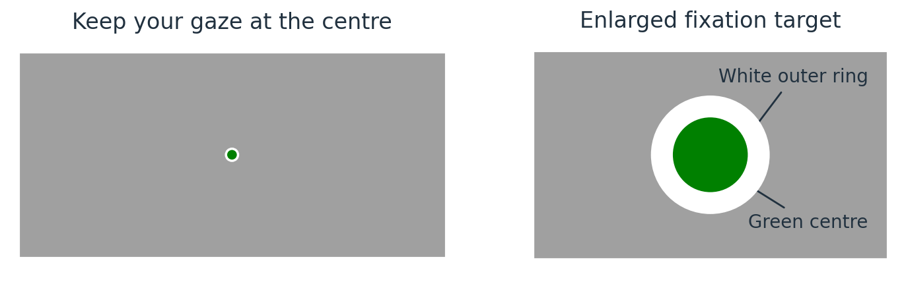
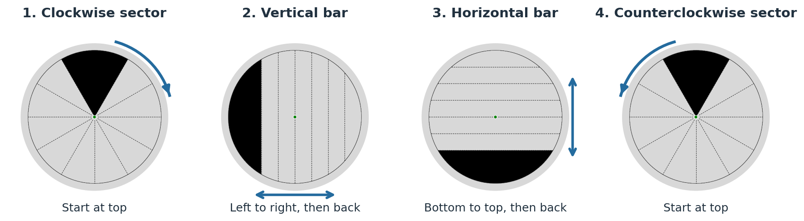
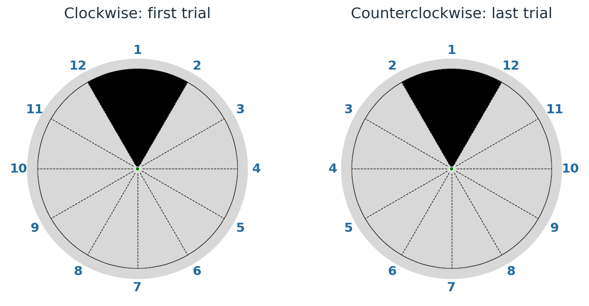
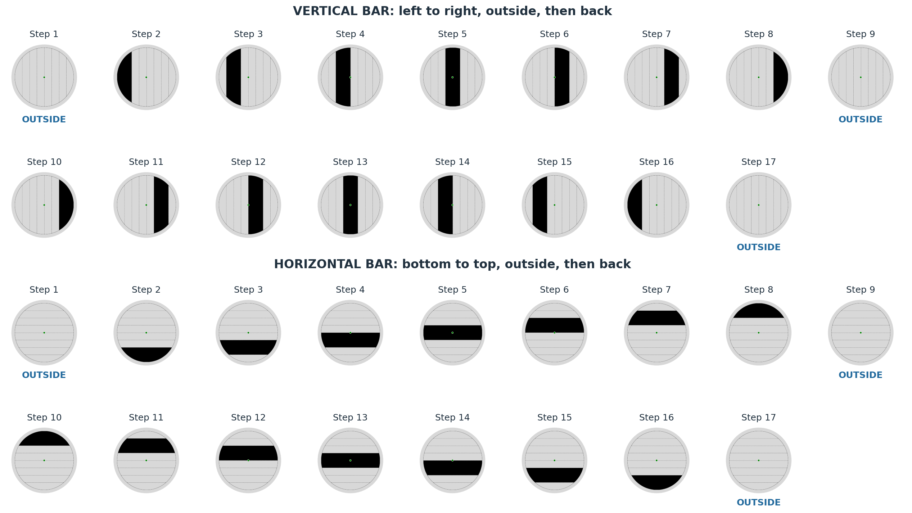
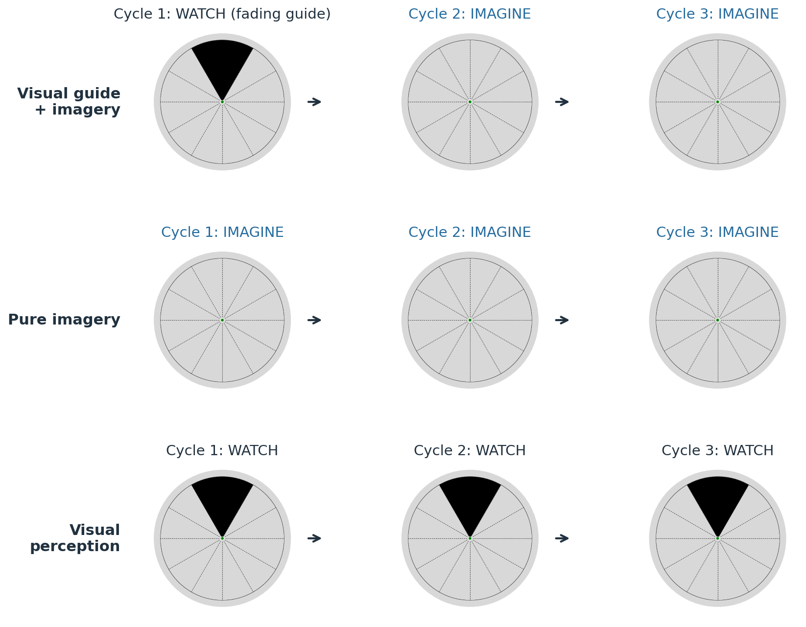

# Imagery and visual perception experiment

## Your task

In this experiment, you will either **watch** or **imagine** a black shape moving
through a circular grid. Short tones tell you when to move to the next position.
The researcher will tell you which type of run you are about to do.

**Keep your eyes open and look at the green fixation point throughout the run.**
The point has a white outer ring. Keep your gaze at the centre even when the
shape moves elsewhere. Keep your head and body still. No button response is
required.

*Figure 1. Look at the green centre. The enlarged view on the right shows the
fixation target clearly; it is not the size shown during the experiment.*

## The same four trials in every run

The order is always: **clockwise sector, vertical bar, horizontal bar,
counterclockwise sector**. In imagery runs, remember this order to know which
movement to imagine. The first sector trial goes clockwise; the last goes
counterclockwise.

*Figure 2. The examples show the shapes you will watch or imagine. During imagery,
the shape itself is absent: only the grid and fixation remain visible. All
figures are teaching illustrations, not displays at the experiment's physical size.*

<!-- pagebreak -->

## Sector: move around the circle

The sector is a wedge-shaped piece of the circle. Each cycle starts with the
wedge at the **top**. At each position tone, move one position around the grid.
There are 12 positions in one complete rotation.

- **First trial:** move clockwise, like the hands of a clock.
- **Last trial:** move counterclockwise, in the opposite direction.
- When a cycle finishes, start the next cycle at the top again.

*Figure 3. Follow positions 1 to 12 in the indicated direction. One position lasts
two seconds when the scanner TR is one second. The numbers and arrows are for
learning; they do not appear during the experiment.*

## Bars: travel across, leave the grid, then return

The **vertical bar** moves from left to right, goes outside the grid for one
position, then moves from right to left and goes outside once more.
The **horizontal bar** follows the same pattern from bottom to top and back.

**Start the bar trial with one extra blank grid and a high tone**, then move to
the first visible edge bar. Later cycles start directly at the visible edge bar. At an outside-grid position,
the grid stays visible but the bar is absent. In imagery, imagine that the bar
has moved outside the circle. At the next position tone, return to the adjacent
edge bar and travel back across the grid. Each outside-grid step lasts one
position interval, just like a visible bar position.

*Figure 4. Read each pair of rows left to right: steps 1–9, then 10–17. Step 1 is
outside the starting edge, step 9 is outside the far edge, and step 17 is
outside the starting edge. For later cycles, skip step 1 and repeat from step 2,
so there is only one blank between cycles. Outside-grid steps are part of the trial, not a rest break.*

<!-- pagebreak -->

## What to do in each type of run

The researcher will name the run type before it starts. The movement order and
fixation instructions are the same in all three types.

*Figure 5. Each circle represents one complete movement cycle, not one position.
The pictures illustrate the screen: a black wedge is visible while watching;
the grid alone is visible while imagining.*

### Visual guide + imagery

First **watch one complete cycle**. The visible shape gradually fades during
this guide. Then **imagine two complete cycles** of the same shape following
the same path and rhythm. Keep looking at fixation throughout.

This is **one visible guide plus two imagery cycles: three cycles in total**.
The change to imagery is part of the ongoing sequence; keep following the
position tones without waiting for a separate spoken instruction.

### Pure imagery

**Imagine three complete cycles**. No moving black shape will be shown.
Use the grid, the remembered movement order, and the tones to place the imagined
shape. Try to picture the shape at each position while keeping your eyes on
fixation.

### Visual perception

**Watch three complete cycles** of the visible shape. Keep your eyes at fixation
and let the shape move through the surrounding grid. Do not follow it with your
eyes. These trials start with the same four-second grid and two-tone
preparation as imagery runs.

<!-- pagebreak -->

## How to use the tones

The tones pace the movement. **Each position tone starts the next position.**
Hold the shape there until the next position tone. At the usual TR of one
second, position tones are two seconds apart.

- A **low tone** marks an ordinary position.
- A **high tone** marks sector cardinal positions, the central bar, and a
  bar's outside-grid positions. Each bar trial starts with one extra high tone and
  a blank grid before the first visible edge bar; later cycles skip this extra blank.
- A high tone can therefore occur within a cycle. It does not always mean that
  a new trial or a rest has started.

Before every trial, you will hear **two low preparation tones**, two seconds
apart. The first position starts two seconds after the second preparation
tone. Use this time to prepare the correct shape, starting position, and direction. Pure imagery also has a brief high onset tone immediately before
the position sequence. Follow the regular position rhythm after preparation.

## Beginning, breaks, and finishing

At the beginning, wait while the scanner gets ready. When fixation and the
sector grid appear, keep looking at the green centre and wait for the first
trial. This initial rest lasts **10 scanner intervals**, usually 10 seconds.

Between trials there is also a **10-interval rest**. The next trial's grid is
already visible during this rest. **A visible grid alone does not mean you
should start imagining.** Rest during the silent break; begin the next sequence
after the two preparation tones. All run types use the same preparation
period before the first position tone.

After the last counterclockwise sector trial, keep looking at fixation for the
**10-interval final rest**. Fixation remains visible while the run finishes and
the files are saved. Wait for the researcher before moving or starting another
run. A run takes approximately **seven minutes**.

## Before you begin

Make sure you can distinguish the low and high tones and understand both bar
turnarounds. Ask the researcher to demonstrate anything that is unclear. If you
lose your place during a run, keep looking at fixation and rejoin the sequence
when you can.

Remember these three instructions:

1. **Eyes open; gaze at the green centre.**
2. **One position per position tone.**
3. **Watch or imagine according to the run type.**
